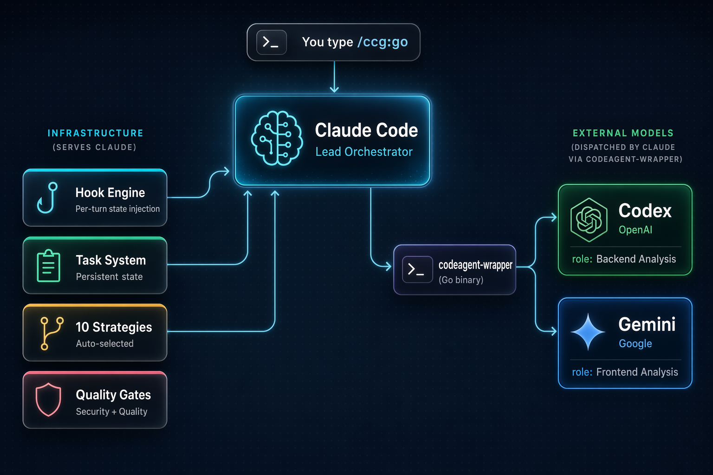

# CCG-ROS2 - Multi-Model ROS2 Development

<div align="center">


[](https://github.com/GuYu-001/ccg-ros2-workflow)
[](https://www.npmjs.com/package/ccg-ros2-workflow)
[](https://www.npmjs.com/package/ccg-ros2-workflow)
[](https://opensource.org/licenses/MIT)
[](https://github.com/GuYu-001/ccg-ros2-workflow/actions/workflows/ci.yml)
[](https://codecov.io/gh/GuYu-001/ccg-ros2-workflow)
[](https://claude.ai/code)
[](https://nodejs.org/)
[](https://x.com/CCG_Workflow)

[](https://ccg.fengshao1227.com/)
[](https://deepwiki.com/GuYu-001/ccg-ros2-workflow)

[简体中文](./README.zh-CN.md) | English | [**Documentation**](https://ccg.fengshao1227.com/)

</div>

## ♥️ Sponsor

[](https://www.packyapi.ai/register?aff=m21P)

Thanks to [PackyCode](https://www.packyapi.ai/register?aff=m21P) for sponsoring this project! PackyCode is a stable, high-throughput API gateway for leading models — one domain, one key, automatic failover, 97% availability. Dedicated high-speed routes for Codex and Claude Code. Pay in RMB 1:1 with no FX markup or top-up fees; new users get a first-charge discount plus $1 in free credits, and eligible groups start from 20% of list price. [Sign up here](https://www.packyapi.ai/register?aff=m21P) to get started.

> 💡 PackyCode also exposes an Anthropic-compatible endpoint, so it can serve as your API provider for Claude Code itself — run `npx ccg-ros2-workflow`, pick PackyCode at Step 1, and paste your key.

---

[](https://go.apimart.ai/gh-ccg-workflow)

Thanks to [APIMart](https://go.apimart.ai/gh-ccg-workflow) for sponsoring this project! APIMart is a low-cost API platform for AI image & video generation — GPT-Image-2 from $0.006/image, 160+ images per dollar. One async API covers both image and video: submit a task, get an ID, fetch results via polling or callback. Batch tens of thousands of images without timeouts, switch models without changing code. Pay-as-you-go with no monthly fee — [sign up here](https://go.apimart.ai/gh-ccg-workflow) to get started.

> 💡 APIMart also exposes an Anthropic-compatible endpoint, so it can serve as your API provider for Claude Code itself — run `npx ccg-ros2-workflow`, pick APIMart at Step 1, and paste your key.

---

[](https://x6.ai)

[x6.ai](https://x6.ai): One API key for every major model. Official-key and proxy channels, up to 90% off, free credits on sign-up. Pay with Alipay, Google Pay, Apple Pay, Visa or Mastercard.

> 💡 x6.ai also exposes an Anthropic-compatible endpoint, so it can serve as your API provider for Claude Code itself — run `npx ccg-ros2-workflow`, pick x6.ai at Step 1, and paste your key.

---

## Choose the skills you use (v3.7.0)

Install native skills independently, or select them during the CCG setup wizard. Each selected skill gets a `ccg-` entry; its scripts and references live in a versioned source cache.

```bash
npx ccg-ros2-workflow skills catalog
npx ccg-ros2-workflow skills install verify-quality ros2-control
npx ccg-ros2-workflow skills list --installed --json
npx ccg-ros2-workflow skills update
npx ccg-ros2-workflow skills remove ros2-control
# Codex native skills
npx ccg-ros2-workflow skills install verify-quality --target codex
# Configure the framework with a saved selection
npx ccg-ros2-workflow init --skills verify-quality,verify-security
npx ccg-ros2-workflow doctor --json
```

Claude Code uses `/ccg-verify-quality`; Codex uses `$ccg-verify-quality`. The manager exposes only selected entries, keeps supporting resources together, refuses ownership conflicts and preserves edited caches. The menu has **S. Manage Skills** and **V. Doctor**. Reinstalling retains the latest selection; `--skills all` selects the catalog and `--skills none` selects none. Existing full installations remain available as compatibility mode.

`doctor --json` returns a versioned report with check IDs, status, remediation, and failure/warning counts. It detects the actual Claude/Codex/Skills-only mode, validates the selected backends (including review routes), Hook registrations and managed skills. Failures exit with code 1. Version and filesystem checks establish configuration health; they do not call a model or prove vendor API access.

Standalone Codex mode checks its own CLI, configuration and installed files. Missing shared Claude routing is optional; missing external delegation tools are reported as warnings with setup instructions.

Model-action Hooks now follow the configured routes and concrete model IDs, avoid duplicate calls to one backend, and use native Agents for pure Claude setups. Native mode uses on-demand skill discovery; legacy knowledge excerpts have a fixed size limit.

### Use an OpenCode worker, including DeepSeek

Configure your provider in OpenCode with `/connect`, then query `opencode models` (or `opencode models deepseek`) for its actual model IDs. In CCG's model menu choose **OpenCode** and enter that `provider/model`. Keep Claude Code as the coordinator; the worker runs through the existing wrapper. CCG preserves the chosen model when changing routing, reinstalling or updating, and does not manage the provider credentials.

## What is CCG-ROS2?

**CCG-ROS2 is a ROS2 development workflow engine for Claude Code**, based on upstream CCG. Claude orchestrates while Codex handles low-level control and Antigravity handles upper-layer applications. Grok, Kimi Code, OpenCode, Claude, and Gemini remain configurable backends through the Go binary bridge.

### ROS2 Focus

The default target is **ROS2 Humble** on physical robots; the engine checks the project's actual distribution and workspace. `/ccg:go` reads `package.xml`, colcon package topology, launch files, parameters and interfaces, then maps `perception`, `control`, `navigation`, `manipulation`, `hardware` and `upper-app` to the corresponding `ros2-*` skills. Native mode loads only selected, discovered skills; compatibility mode uses the bundled resources.

Across all seven model backends, **backend** means C++ `rclcpp`, drivers, real-time control and `ros2_control`; **frontend** means Python `rclpy`, launch, parameters, RViz/Gazebo and Nav2/MoveIt configuration. The [54-role inventory](./docs/ros2-prompt-inventory.md) records every prompt and its consumers. Roles cover package boundaries, `.msg/.srv/.action`, Topic/Service/Action and QoS compatibility, lifecycle, executors/callback groups, tf2 and hardware safety.

One command. Describe what you want. The engine handles the rest.

```bash
npx ccg-ros2-workflow    # Install in 60 seconds
```

## Architecture

<div align="center">

</div>

**Claude Code** is the lead orchestrator. It analyzes your intent, selects a strategy, and manages the entire workflow. The **Hook Engine** injects state every turn so Claude never loses context — even after compaction. The **codeagent-wrapper** (a compiled Go binary) bridges Claude to external models for parallel analysis and review.

## How It Works

```
You: /ccg:go add a lifecycle-managed motor controller

Entry:
  Reads git/project context + package.xml/colcon/launch/interfaces
  Classifies feature / L complexity / control / high risk
  Creates task.json and selects full-collaborate

full-collaborate: seven stages
  1. Research and context analysis
  2. Multi-model solution design
  3. Detailed plan → HARD STOP for your approval and execution-mode choice
  4. Implementation using the approved mode
  5. Iterative cross-review and fixes
  6. Final software validation
  7. Hardware deployment preparation → record outcome, confirm and archive
```

At plan approval, you choose Agent Teams or external-model Builders; the engine does not silently choose a team. `guided-develop` also has seven stages: requirements, context, model analysis, plan approval, implementation, verification with iterative review, and deployment preparation. Its implementation choice is Claude or external-model Builders. The five other code-changing strategies keep their compact phases and call the same ROS2 validation/deployment checks before completion.

ROS2 software gates run `colcon build`, `colcon test`, `colcon test-result --verbose` and relevant `launch_testing` in an isolated or simulated configuration. Deployment preparation covers a dry-run/simulation-default deployment script, read-only hardware dependency checks, Gazebo validation when available, and delivery/rollback instructions. Missing ROS/SDK, required simulation resources or hardware is recorded as **blocked / not run**, never passed. Simulation does not establish real-robot safety.

Physical activation, motor motion, CAN/serial writes, host permission changes and changes to safety limits require separate explicit approval. A prepared deployment is not a claim that a robot is live. Non-ROS2 tasks or an explicit deployment opt-out record `deployment.status: "skipped"` and still archive normally; skipped deployment never skips required software validation.

Every turn, a hook injects the task breadcrumb:

```text
  <ccg-state>
  Task: add-motor-controller (in_progress)
  Strategy: full-collaborate
  Phase: 4-implementation
  </ccg-state>
```

## 10 Built-in Strategies

The engine auto-selects the right strategy based on task type and complexity:

| Strategy | When | External Models | Agent Teams |
|----------|------|:---:|:---:|
| `direct-fix` | Simple bug, single file | — | — |
| `quick-implement` | Small feature, clear scope | — | — |
| `guided-develop` | Medium feature, needs planning | Dual analysis/review | — |
| `full-collaborate` | Complex feature, multi-module | Dual parallel | User-selected |
| `debug-investigate` | Complex bug, unknown cause | Dual diagnosis | — |
| `refactor-safely` | Code restructuring | Dual review | — |
| `deep-research` | Technical research | Dual exploration | — |
| `optimize-measure` | Performance optimization | Optional | — |
| `review-audit` | Code review | Dual cross-review | — |
| `git-action` | commit, rollback, branches | — | — |

Small tasks use compact workflows. ROS2 safety checks apply even to one-line changes.

## Core Features

### Hook Engine — Never Lose Context

4 JavaScript hooks inject state into every Claude Code session:

| Hook | Event | What it does |
|------|-------|-------------|
| `workflow-state.js` | Every turn | Injects current task state as breadcrumb |
| `session-start.js` | Session start/compact | Re-injects full project context |
| `subagent-context.js` | Agent/Bash spawn | Injects spec directly into subagent prompts |
| `skill-router.js` | Every turn | Auto-injects domain knowledge by keyword |

Context survives compaction. Sub-agents born with spec in their prompt. Zero state loss.

### Task System — Persistent Lifecycle

Medium+ complexity tasks get a persistent directory:

```
.ccg/tasks/add-motor-controller/
├── task.json         # Status, strategy, phase, gate
├── requirements.md   # Enhanced requirements
├── plan.md           # Approved implementation plan
├── context.jsonl     # Spec files for sub-agent injection
├── review.md         # Review results
└── research/         # Persisted research findings
```

### Quality Gates — Built-in Security & Quality

| Gate | Trigger |
|------|---------|
| `/ccg:verify-security` | New modules, security changes |
| `/ccg:verify-quality` | Changes > 30 lines |
| `/ccg:verify-change` | Doc sync check |
| `/ccg:verify-module` | Module structure check |
| `/ccg:gen-docs` | Auto-generate README + DESIGN |

ROS2 code changes also use the shared software and deployment gates above. The Codex workflow Hook flags motor/actuator control, emergency stops, real-time loops, CAN/serial writes and safety limits from task intent, changed paths and staged/unstaged diffs. These reminders require independent safety review; they do not replace a hardware safety system.

### 100+ Domain Knowledge Files

Domain knowledge includes general engineering and six ROS2 specializations:

`Security` · `Architecture` · `DevOps` · `AI/MLOps` · `Development` · `Infrastructure` · `Mobile` · `Data Engineering` · `Orchestration` · `ROS2 Upper App` · `ROS2 Perception` · `ROS2 Control` · `ROS2 Navigation` · `ROS2 Manipulation` · `ROS2 Hardware`

## Commands

### Core (v3.0 default: 13 commands)

| Command | Description |
|---------|-------------|
| `/ccg:go` | **Smart entry** — describe what you want, engine handles the rest |
| `/ccg:commit` | Smart conventional commit |
| `/ccg:rollback` | Interactive rollback |
| `/ccg:clean-branches` | Clean merged branches |
| `/ccg:worktree` | Worktree management |
| `/ccg:init` | Initialize project CLAUDE.md |
| `/ccg:context` | Project context management |

### OpenSpec Integration

| Command | Description |
|---------|-------------|
| `/ccg:spec-init` | Initialize OPSX environment |
| `/ccg:spec-research` | Requirements → constraints |
| `/ccg:spec-plan` | Constraints → zero-decision plan |
| `/ccg:spec-impl` | Execute plan + archive |
| `/ccg:spec-review` | Dual-model cross-review |

### Legacy Mode (18 additional commands)

Includes `/ccg:workflow`, `/ccg:plan`, `/ccg:execute`, `/ccg:frontend`, `/ccg:backend`, `/ccg:analyze`, `/ccg:debug`, `/ccg:optimize`, `/ccg:test`, `/ccg:review`, `/ccg:team`, and more.

## Quick Start

**Option A — full install (multi-model orchestration + commands + hooks + binary, recommended)**

```bash
# Install (interactive 4-step wizard)
npx ccg-ros2-workflow

# Or non-interactive with defaults
npx ccg-ros2-workflow init --skip-prompt
```

Requires **Node.js 20+** and **Claude Code CLI**. Codex CLI, Grok CLI, Kimi Code CLI, and Antigravity are optional (enable multi-model features).

**Option B — native plugin (skills only, zero dependencies, v3.5.1+)**

Want just the ROS2 domain knowledge, engineering references, and quality gates without the multi-model orchestration?

```bash
claude plugin marketplace add GuYu-001/ccg-ros2-workflow
claude plugin install ccg@ccg
```

Skills are invoked as `/ccg:<skill>`. No npx, no binary. The multi-model commands ship only through Option A (their templates carry install-time placeholders that a native plugin can't resolve).

## CLI Commands

```bash
npx ccg-ros2-workflow                          # Interactive menu
npx ccg-ros2-workflow init                     # 4-step install wizard
npx ccg-ros2-workflow doctor                   # Environment health check
npx ccg-ros2-workflow doctor --json            # Machine-readable health report
npx ccg-ros2-workflow skills list              # Catalog and native selection
npx ccg-ros2-workflow status                   # Installation overview
npx ccg-ros2-workflow codex-mode install       # Install Codex-Led mode
npx ccg-ros2-workflow codex-mode uninstall     # Uninstall Codex-Led mode
npx ccg-ros2-workflow uninstall                # Uninstall CCG
npx ccg-ros2-workflow config mcp               # Configure MCP tokens
npx ccg-ros2-workflow diagnose-mcp             # Diagnose MCP issues
```

## Configuration

```
~/.claude/
├── commands/ccg/          # Slash commands
├── hooks/ccg/             # Hook scripts (5 files)
├── skills/ccg/            # Legacy bundled skills
├── skills/ccg-<slug>      # Selected native skill entries
├── .ccg-skills/           # Native selection manifest and resource cache
├── rules/                 # Auto-trigger rules
├── .ccg/
│   ├── config.toml        # Model routing, MCP, performance
│   ├── engine/            # 10 strategy files + model router
│   └── prompts/           # 54 role prompts across seven model backends
└── bin/codeagent-wrapper  # Multi-model bridge (Go binary)
```

### Environment Variables

Set in `~/.claude/settings.json` under `"env"`:

| Variable | Default | Description |
|----------|---------|-------------|
| `CODEX_TIMEOUT` | `7200` | Wrapper timeout (seconds) |
| `CODEAGENT_POST_MESSAGE_DELAY` | `5` | Post-completion delay |
| `CLAUDE_CODE_EXPERIMENTAL_AGENT_TEAMS` | unset | Set `1` for parallel Agent Teams |

## Update / Uninstall

```bash
npx ccg-ros2-workflow@latest     # Update to latest
npx ccg-ros2-workflow doctor     # Check health after update
npx ccg-ros2-workflow uninstall  # Clean uninstall
```

## Credits

- [stellarlinkco/myclaude](https://github.com/stellarlinkco/myclaude) — codeagent-wrapper inspiration
- [UfoMiao/zcf](https://github.com/UfoMiao/zcf) — Git tools reference
- [mindfold-ai/Trellis](https://github.com/mindfold-ai/Trellis) — Hook-based workflow state patterns
- [ace-tool](https://linux.do/t/topic/1344562) — MCP code retrieval

## Contributors

<!-- readme: contributors -start -->
<table>
<tr>
    <td align="center"><a href="https://github.com/fengshao1227"><br /><sub><b>fengshao1227</b></sub></a></td>
    <td align="center"><a href="https://github.com/SXP-Simon"><br /><sub><b>SXP-Simon</b></sub></a></td>
    <td align="center"><a href="https://github.com/RebornQ"><br /><sub><b>RebornQ</b></sub></a></td>
    <td align="center"><a href="https://github.com/Sakuranda"><br /><sub><b>Sakuranda</b></sub></a></td>
    <td align="center"><a href="https://github.com/Mriris"><br /><sub><b>Mriris</b></sub></a></td>
    <td align="center"><a href="https://github.com/23q3"><br /><sub><b>23q3</b></sub></a></td>
    <td align="center"><a href="https://github.com/MrNine-666"><br /><sub><b>MrNine-666</b></sub></a></td>
</tr>
<tr>
    <td align="center"><a href="https://github.com/GGzili"><br /><sub><b>GGzili</b></sub></a></td>
</tr>
</table>
<!-- readme: contributors -end -->

## Contact

- **X (Twitter)**: [@CCG_Workflow](https://x.com/CCG_Workflow)
- **Email**: [fengshao1227@gmail.com](mailto:fengshao1227@gmail.com)
- **Issues**: [GitHub Issues](https://github.com/GuYu-001/ccg-ros2-workflow/issues)
- **Community**: [Linux.do](https://linux.do)

## Star History

[](https://www.star-history.com/#GuYu-001/ccg-ros2-workflow&type=timeline&legend=top-left)

## License

MIT

---

v3.7.2-ros2.0 | [Issues](https://github.com/GuYu-001/ccg-ros2-workflow/issues) | [Contributing](./CONTRIBUTING.md)
