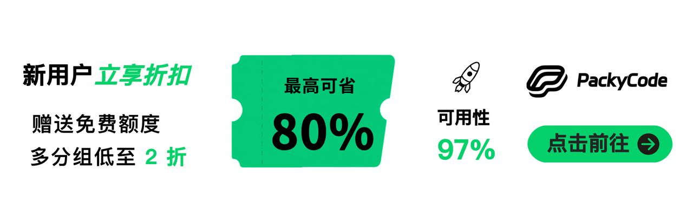
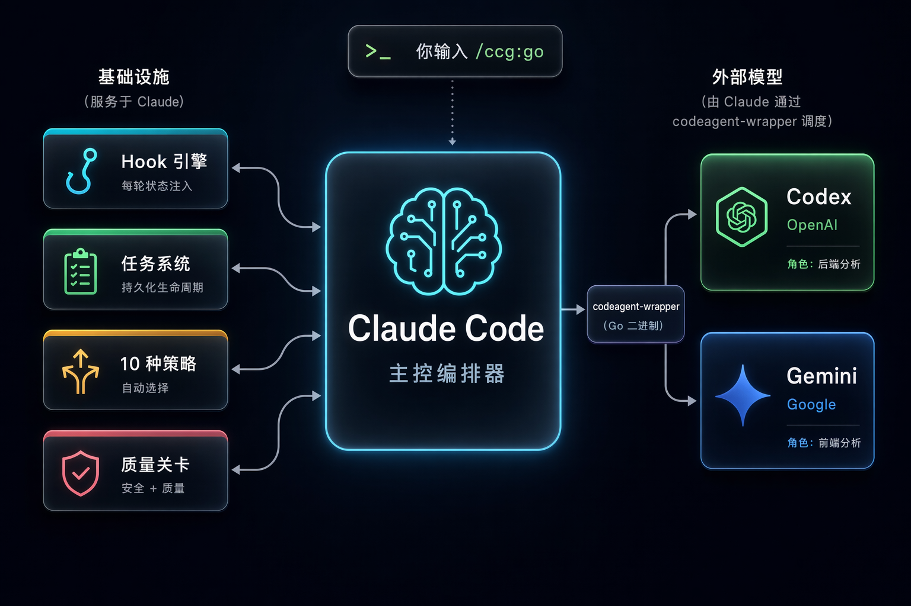

# CCG-ROS2 - ROS2 多模型协作开发

<div align="center">


[](https://github.com/GuYu-001/ccg-ros2-workflow)
[](https://www.npmjs.com/package/ccg-ros2-workflow)
[](https://www.npmjs.com/package/ccg-ros2-workflow)
[](https://opensource.org/licenses/MIT)
[](https://github.com/GuYu-001/ccg-ros2-workflow/actions/workflows/ci.yml)
[](https://codecov.io/gh/GuYu-001/ccg-ros2-workflow)
[](https://claude.ai/code)
[](https://nodejs.org/)
[](https://x.com/CCG_Workflow)

[](https://ccg.fengshao1227.com/)
[](https://deepwiki.com/GuYu-001/ccg-ros2-workflow)

[简体中文](./README.zh-CN.md) | [English](./README.md) | [**完整文档**](https://ccg.fengshao1227.com/)

</div>

## ♥️ Sponsor

[](https://www.packyapi.ai/register?aff=m21P)

感谢 [PackyCode](https://www.packyapi.ai/register?aff=m21P) 赞助了本项目！PackyCode 是稳定、高效的 API 中转服务商，一句话接入主流大模型。统一域名、统一密钥、智能容灾切换，97% 可用性。人民币 1:1 充值，无汇率无手续费坑；新用户首充立享折扣 + $1 免费体验额度，多分组折扣低至 2 折起，提供专属 Codex / Claude Code 高速通道。通过[此注册链接](https://www.packyapi.ai/register?aff=m21P)注册即可开用。

> 💡 PackyCode 同时提供 Anthropic 原生兼容端点，可直接作为 Claude Code 的 API 提供方 —— 运行 `npx ccg-ros2-workflow` 在 Step 1 选择 PackyCode，填入 Key 即可。

---

[](https://go.apimart.ai/gh-ccg-workflow)

感谢 [APIMart](https://go.apimart.ai/gh-ccg-workflow) 赞助了本项目！APIMart 是专注 AI 图片/视频生成的低价 API 平台，GPT-Image-2 低至 $0.006/张，1 美元可出图 160+ 张。图片、视频一套异步 API 通吃，提交任务拿 ID、回调取结果，跑批万张不超时、换模型不改代码。按量付费、无月费，通过[此注册链接](https://go.apimart.ai/gh-ccg-workflow)注册即可开用。

> 💡 APIMart 同时提供 Anthropic 原生兼容端点，可直接作为 Claude Code 的 API 提供方 —— 运行 `npx ccg-ros2-workflow` 在 Step 1 选择 APIMart，填入 Key 即可。

---

[](https://x6.ai)

[x6.ai](https://x6.ai)：一个 Key 调用所有主流模型，官 Key 直连和反代双通道，最低 1 折，注册送免费额度。支持支付宝、Google Pay、Apple Pay、Visa、Mastercard。

> 💡 x6.ai 同时提供 Anthropic 原生兼容端点，可直接作为 Claude Code 的 API 提供方 —— 运行 `npx ccg-ros2-workflow` 在 Step 1 选择 x6.ai，填入 Key 即可。

---

## 只安装需要的 Skills（v3.7.0）

Skills 可以独立安装，也可以在 CCG 初始化向导里选择。每个选中的技能都有一个 `ccg-` 原生入口，脚本和参考资料保存在版本化源码缓存里。

```bash
npx ccg-ros2-workflow skills catalog
npx ccg-ros2-workflow skills install verify-quality ros2-control
npx ccg-ros2-workflow skills list --installed --json
npx ccg-ros2-workflow skills update
npx ccg-ros2-workflow skills remove ros2-control
# 装入 Codex 原生 Skills
npx ccg-ros2-workflow skills install verify-quality --target codex
# 给完整框架保存按需选择
npx ccg-ros2-workflow init --skills verify-quality,verify-security
npx ccg-ros2-workflow doctor --json
```

Claude Code 使用 `/ccg-verify-quality`，Codex 使用 `$ccg-verify-quality`。管理器只暴露选中的入口，保留完整资源依赖，遇到归属冲突会拒绝覆盖，修改过的缓存也会保留。菜单新增 **S. Skills 管理**、**V. 环境诊断**。重装沿用最新选择；`--skills all` 选择完整目录，`--skills none` 为空选择。已有全量安装可继续使用兼容模式。

`doctor --json` 输出带 schema 版本的检查报告，包括 check ID、状态、修复指引和失败/警告数量。它识别真实 Claude/Codex/Skills-only 模式，检查所选后端（包括审查路由）、Hook 注册和受管技能；失败退出码为 1。版本和文件检查验证配置状态，不调用模型，也不代表厂商 API 可用性验证。

独立 Codex 模式检查自身 CLI、配置和已安装文件；共享 Claude 路由配置为可选，缺少外部模型委派工具时给出警告和安装指引。

模型动作 Hook 跟随实际路由和具体型号，同一后端只调用一次；纯 Claude 配置使用原生 Agent。原生模式按需发现技能，兼容模式的知识片段有固定大小上限。

### Claude 规划，OpenCode / DeepSeek 实施

先在 OpenCode 用 `/connect` 配好 provider，再运行 `opencode models`（DeepSeek 可用 `opencode models deepseek`）查询实际型号。在 CCG 模型菜单选择 **OpenCode** 并填写对应的 `provider/model`。Claude Code 继续负责主控，worker 通过已有 wrapper 执行；改路由、重装和更新都会保留型号，CCG 不接管 provider 凭据。

## CCG-ROS2 是什么？

**CCG-ROS2 是基于上游 CCG 的 ROS2 开发工作流引擎。** Claude 负责主控编排，Codex 负责底层控制，Antigravity 负责上层应用；通过 Go 编译的 codeagent-wrapper 也可配置 Grok、Kimi Code、OpenCode、Claude、Gemini 等后端。

### ROS2 专项能力

默认面向实体机器人的 **ROS2 Humble**。内置六个领域技能：`ros2-upper-app`、`ros2-perception`、`ros2-control`、`ros2-navigation`、`ros2-manipulation`、`ros2-hardware`，覆盖节点边界、消息接口、QoS、生命周期、硬件安全与仿真验证。

一条命令，描述你要做什么，引擎自动处理一切。

```bash
npx ccg-ros2-workflow    # 60 秒安装
```

## 架构

<div align="center">

</div>

**Claude Code** 是主控编排器。它分析你的意图、选择策略、管理整个工作流。**Hook 引擎**每轮注入状态，确保 Claude 永不丢失上下文 —— 即使上下文被压缩。**codeagent-wrapper**（编译的 Go 二进制）作为桥梁，将 Claude 连接到外部模型进行并行分析和审查。

## 工作流程

```
你: /ccg:go 添加带生命周期管理的电机控制器

CCG 引擎:
  1. 读取项目上下文（git 状态、技术栈、文件结构）
  2. 分类：功能 / L 复杂度 / 底层控制 / 高风险
  3. 选择策略：full-collaborate（全协作）
  4. 创建 .ccg/tasks/add-motor-controller/task.json
  5. 启动已配置模型分析（默认 Codex + Antigravity）
  6. 生成计划 → 硬停等你审批
  7. 派生 Agent Teams Builder 并行实施
  8. 运行质量关卡 + 双模型交叉审查
  9. 报告结果

每一轮，Hook 自动注入：
  <ccg-state>
  任务: add-motor-controller (进行中)
  策略: full-collaborate
  阶段: 4-实施
  </ccg-state>
```

## 10 种内置策略

引擎根据任务类型和复杂度自动选择最佳策略：

| 策略 | 适用场景 | 外部模型 | Agent Teams |
|------|---------|:---:|:---:|
| `direct-fix` | 简单 bug，单文件 | — | — |
| `quick-implement` | 小功能，范围明确 | — | — |
| `guided-develop` | 中等功能，需要规划 | 单模型 | — |
| `full-collaborate` | 复杂功能，跨模块 | 双模型并行 | ✓ |
| `debug-investigate` | 复杂 bug，原因未知 | 双模型诊断 | — |
| `refactor-safely` | 代码重构 | 双模型审查 | — |
| `deep-research` | 技术调研 | 双模型探索 | — |
| `optimize-measure` | 性能优化 | 可选 | — |
| `review-audit` | 代码审查 | 双模型交叉审查 | — |
| `git-action` | commit、rollback、分支 | — | — |

简单任务零开销快速执行。复杂任务调动全部引擎能力。

## 核心能力

### Hook 引擎 — 永不丢失上下文

4 个 JavaScript Hook 为每个 Claude Code 会话注入状态：

| Hook | 触发时机 | 作用 |
|------|---------|------|
| `workflow-state.js` | 每轮用户消息 | 注入当前任务状态面包屑 |
| `session-start.js` | 会话开始/压缩 | 重新注入完整项目上下文 |
| `subagent-context.js` | Agent/Bash 调用 | 将 spec 直接注入子 agent 的 prompt |
| `skill-router.js` | 每轮用户消息 | 按关键词自动注入域知识 |

上下文在压缩后自动恢复。子 agent 出生即带 spec。零状态丢失。

### 任务系统 — 持久化生命周期

中等及以上复杂度的任务获得持久化目录：

```
.ccg/tasks/add-motor-controller/
├── task.json         # 状态、策略、阶段、门控
├── requirements.md   # 增强需求
├── plan.md           # 已审批的实施计划
├── context.jsonl     # 子 agent 注入的 spec 文件
├── review.md         # 审查结果
└── research/         # 持久化研究成果
```

### 质量关卡 — 内置安全与质量检查

| 关卡 | 触发条件 |
|------|---------|
| `/ccg:verify-security` | 新模块、安全相关变更 |
| `/ccg:verify-quality` | 变更超过 30 行 |
| `/ccg:verify-change` | 文档同步检查 |
| `/ccg:verify-module` | 模块结构检查 |
| `/ccg:gen-docs` | 自动生成 README + DESIGN |

### 100+ 域知识秘典

领域知识同时覆盖通用工程与六个 ROS2 专项领域：

`安全` · `架构` · `DevOps` · `AI/MLOps` · `开发语言` · `基础设施` · `移动端` · `数据工程` · `编排` · `ROS2 上层应用` · `ROS2 感知` · `ROS2 控制` · `ROS2 导航` · `ROS2 操作` · `ROS2 硬件`

## 命令

### 核心命令（v3.0 默认安装 13 个）

| 命令 | 说明 |
|------|------|
| `/ccg:go` | **智能入口** — 描述你要做什么，引擎自动处理 |
| `/ccg:commit` | 智能 Conventional Commit |
| `/ccg:rollback` | 交互式回滚 |
| `/ccg:clean-branches` | 清理已合并分支 |
| `/ccg:worktree` | Worktree 管理 |
| `/ccg:init` | 初始化项目 CLAUDE.md |
| `/ccg:context` | 项目上下文管理 |

### OpenSpec 集成

| 命令 | 说明 |
|------|------|
| `/ccg:spec-init` | 初始化 OPSX 环境 |
| `/ccg:spec-research` | 需求 → 约束集 |
| `/ccg:spec-plan` | 零决策可执行计划 |
| `/ccg:spec-impl` | 按规范实施 + 归档 |
| `/ccg:spec-review` | 双模型交叉审查 |

### Legacy 模式（额外 18 个命令）

包括 `/ccg:workflow`、`/ccg:plan`、`/ccg:execute`、`/ccg:frontend`、`/ccg:backend`、`/ccg:analyze`、`/ccg:debug`、`/ccg:optimize`、`/ccg:test`、`/ccg:review`、`/ccg:team` 等。

## 快速开始

**方式 A：完整安装（多模型编排 + 命令 + hooks + binary，推荐）**

```bash
# 安装（交互式 4 步向导）
npx ccg-ros2-workflow

# 或非交互式使用默认配置
npx ccg-ros2-workflow init --skip-prompt
```

需要 **Node.js 20+** 和 **Claude Code CLI**。Codex CLI、Grok CLI、Kimi Code CLI 和 Antigravity 为可选（启用多模型功能）。

**方式 B：原生插件（仅技能，零依赖，v3.5.1+）**

只想要 ROS2 领域知识、通用工程参考和质量关卡，不需要多模型编排时：

```bash
claude plugin marketplace add GuYu-001/ccg-ros2-workflow
claude plugin install ccg@ccg
```

技能以 `/ccg:<skill>` 形式调用。无需 npx、无需 binary。多模型命令因含模板占位符不随插件分发，需方式 A。

## CLI 命令大全

```bash
npx ccg-ros2-workflow                          # 交互式菜单
npx ccg-ros2-workflow init                     # 4 步安装向导
npx ccg-ros2-workflow doctor                   # 环境健康检查
npx ccg-ros2-workflow doctor --json            # 机器可读的诊断报告
npx ccg-ros2-workflow skills list              # 查看目录与原生选择
npx ccg-ros2-workflow status                   # 安装概况
npx ccg-ros2-workflow codex-mode install       # 安装 Codex 主导模式
npx ccg-ros2-workflow codex-mode uninstall     # 卸载 Codex 主导模式
npx ccg-ros2-workflow uninstall                # 卸载 CCG
npx ccg-ros2-workflow config mcp               # 配置 MCP Token
npx ccg-ros2-workflow diagnose-mcp             # 诊断 MCP 问题
```

## 配置

```
~/.claude/
├── commands/ccg/          # 斜杠命令
├── hooks/ccg/             # Hook 脚本（5 个文件）
├── skills/ccg/            # 兼容模式的全量技能
├── skills/ccg-<slug>      # 已选择的原生技能入口
├── .ccg-skills/           # 原生选择清单与资源缓存
├── rules/                 # 自动触发规则
├── .ccg/
│   ├── config.toml        # 模型路由、MCP、性能配置
│   ├── engine/            # 10 个策略文件 + 模型路由器
│   └── prompts/           # 专家提示词（codex/gemini/claude）
└── bin/codeagent-wrapper  # 多模型桥接（Go 二进制）
```

### 环境变量

在 `~/.claude/settings.json` 的 `"env"` 中设置：

| 变量 | 默认值 | 说明 |
|------|--------|------|
| `CODEX_TIMEOUT` | `7200` | Wrapper 超时（秒） |
| `CODEAGENT_POST_MESSAGE_DELAY` | `5` | 完成后延迟（秒） |
| `CLAUDE_CODE_EXPERIMENTAL_AGENT_TEAMS` | 未设置 | 设为 `1` 启用 Agent Teams 并行 |

## 更新 / 卸载

```bash
npx ccg-ros2-workflow@latest     # 更新到最新版
npx ccg-ros2-workflow doctor     # 更新后健康检查
npx ccg-ros2-workflow uninstall  # 彻底卸载
```

## 致谢

- [stellarlinkco/myclaude](https://github.com/stellarlinkco/myclaude) — codeagent-wrapper 灵感来源
- [UfoMiao/zcf](https://github.com/UfoMiao/zcf) — Git 工具参考
- [mindfold-ai/Trellis](https://github.com/mindfold-ai/Trellis) — Hook 状态注入模式
- [ace-tool](https://linux.do/t/topic/1344562) — MCP 代码检索

## 贡献者

<!-- readme: contributors -start -->
<table>
<tr>
    <td align="center"><a href="https://github.com/fengshao1227"><br /><sub><b>fengshao1227</b></sub></a></td>
    <td align="center"><a href="https://github.com/SXP-Simon"><br /><sub><b>SXP-Simon</b></sub></a></td>
    <td align="center"><a href="https://github.com/RebornQ"><br /><sub><b>RebornQ</b></sub></a></td>
    <td align="center"><a href="https://github.com/Sakuranda"><br /><sub><b>Sakuranda</b></sub></a></td>
    <td align="center"><a href="https://github.com/Mriris"><br /><sub><b>Mriris</b></sub></a></td>
    <td align="center"><a href="https://github.com/23q3"><br /><sub><b>23q3</b></sub></a></td>
    <td align="center"><a href="https://github.com/MrNine-666"><br /><sub><b>MrNine-666</b></sub></a></td>
</tr>
<tr>
    <td align="center"><a href="https://github.com/GGzili"><br /><sub><b>GGzili</b></sub></a></td>
</tr>
</table>
<!-- readme: contributors -end -->

## 联系

- **X (Twitter)**: [@CCG_Workflow](https://x.com/CCG_Workflow)
- **Email**: [fengshao1227@gmail.com](mailto:fengshao1227@gmail.com)
- **Issues**: [GitHub Issues](https://github.com/GuYu-001/ccg-ros2-workflow/issues)
- **社区**: [Linux.do](https://linux.do)

## Star 历史

[](https://www.star-history.com/#GuYu-001/ccg-ros2-workflow&type=timeline&legend=top-left)

## 许可证

MIT

---

v3.7.2-ros2.0 | [Issues](https://github.com/GuYu-001/ccg-ros2-workflow/issues) | [Contributing](./CONTRIBUTING.md)
